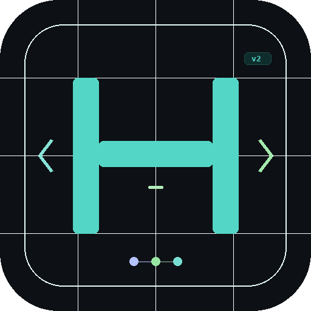
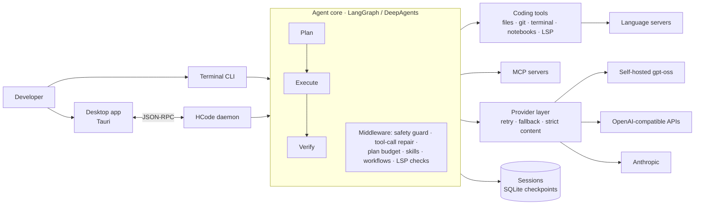

<div align="center">
  
  <h1>HCode v2</h1>
  <p><b>A self-hosted, model-agnostic AI coding agent for the terminal and desktop</b></p>
  <p>
    
    
    
    
    
  </p>
</div>

HCode is an autonomous coding agent: you describe a task, and it plans the change, edits the code, runs commands and verifies its own work. It runs on **your own infrastructure** and works with any OpenAI-compatible model, including self-hosted open-weight models such as `gpt-oss`, so source code never has to leave the company.

Built as my final-year engineering project (PFE) at **KPIT Tunisia**, where HCode was deployed on KPIT's own servers with its self-hosted `gpt-oss` model and received positive feedback.

> **About this repository:** this is a project showcase. The source code is kept private. Access can be granted on request for recruitment purposes.

## How you use it

```text
hcode run <task>        Run a single task (plans, edits, verifies) and print the result
hcode chat              Interactive multi-turn session, resumable across runs
hcode mcp <action>      Manage MCP tool servers: list | known | connect <name>
hcode skill             List the available skills
hcode workflow          List the available workflow files
```

Options include `--workdir` to point the agent at any project, `--fast` to skip planning, and `--session` to resume a previous conversation.

## Key features

- **Plan → Execute → Verify.** The agent writes a plan, carries it out with tools, then checks the result (tests, language-server diagnostics) before reporting back. Plan budgets keep exploration from eating the whole run.
- **Model-agnostic and self-hosted.** Works with any OpenAI-compatible endpoint (self-hosted `gpt-oss`, cloud APIs) or Anthropic, with automatic retry and fallback when a provider is rate-limited.
- **Robust with open-weight models.** Malformed or rejected tool calls are repaired and turned into in-run corrections instead of crashing the session, a common failure mode with smaller models.
- **Safety guard.** Files are backed up before destructive edits so they can be restored, shell commands can require user approval, and file access stays inside the project.
- **Code intelligence.** Language Server Protocol (LSP) integration: after each edit, the agent reads real compiler and type-checker diagnostics.
- **Extensible.** MCP client to connect external tool servers, selectable skills (reusable behaviors loaded on demand) and workflow files.
- **30+ coding tools.** Files, diffs, git, terminal, notebooks, LSP queries, todo tracking.
- **Two interfaces.** An interactive terminal CLI with persistent sessions, and a desktop app (Tauri) driven by a JSON-RPC daemon.

## Architecture



| Layer | Responsibility |
|---|---|
| **Interfaces** | Click-based CLI (`run`, `chat`, `mcp`, `skill`, `workflow`), Tauri desktop app over a JSON-RPC daemon |
| **Agent core** | Built on the open-source DeepAgents harness (LangGraph): agent loop, sub-agents, context summarization, human-in-the-loop |
| **HCode middleware** | Plan-Execute-Verify, safety guard, tool-call repair, plan budgets, selective skills, workflows, post-edit LSP verification, project map |
| **Tools** | 30+ tools exposed as LangChain tools, plus any MCP server |
| **Providers** | OpenAI-compatible and Anthropic clients with resilient retry/fallback and a strict-content adapter for picky endpoints |
| **Persistence** | SQLite checkpointer for resumable sessions |

## Engineering

- **680+ automated tests** covering the agent middleware, tools, providers, daemon and CLI
- Typed agent events shared between the daemon and the desktop UI (React + Monaco editor)
- Developed with feature branches, pull requests and CI

## Tech stack

Python · LangGraph · LangChain · DeepAgents · MCP · Language Server Protocol · Click · SQLite · Tauri (Rust + TypeScript) · `uv` · pytest · GitHub Actions

## Contact

Mohamed Jarboui · AI & Data Science Engineer · [GitHub profile](https://github.com/Mohamed-jarboui)
